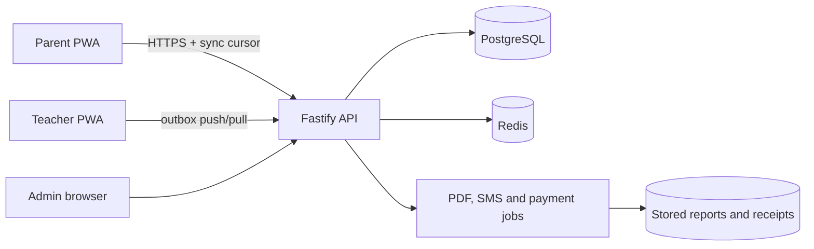

# Architecture

The browser application is role-routed and caches its shell with a service worker. A production client stores authorised rows and an outbox in IndexedDB. UUIDs make replay idempotent; server sync sequences provide ordered incremental pulls. The server remains authoritative, applies policy before returning rows, and rejects writes to locked terms.

The pure functions in `src/domain.ts` own CBC grading, weighted results, report completeness, fee balances, and conflict selection. HTTP contracts live in `server/index.ts`; the included service uses mock persistence so providers and database infrastructure can be developed without credentials.

Sensitive actions must emit an immutable audit row. Learner queries are always constrained by the learner identifier in the authenticated token, never by a client-supplied learner alone.
